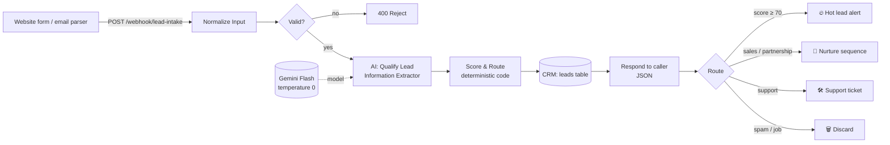

# AI Lead Triage: n8n + Gemini

**Every inbound lead is qualified, scored, saved to the CRM and routed in under 15 seconds, with no human reading the inbox.**

An n8n workflow that takes leads from a website form or an email parser and:

1. uses an LLM (**Gemini Flash**) to extract structured fields (intent, urgency, budget, timeline, company size, use case, summary, and a personalised draft reply) against a strict JSON schema;
2. **scores and routes in deterministic code**, so the business rules stay auditable, testable and cheap to change;
3. saves every lead to a CRM table (n8n Data Table, which you can swap for HubSpot, Sheets or Airtable);
4. replies to the caller instantly, then routes the lead to one of four paths: 🔥 hot-lead alert · 🌱 nurture sequence · 🛠 support ticket · 🗑 discard.



## Why it's built this way

| Decision | Reason |
|---|---|
| **The LLM extracts, code decides** | Routing rules (scoring weights, the hot-lead threshold) live in plain JavaScript. Sales ops can change a number without touching a prompt, and every decision can be explained. |
| **Strict JSON schema with enums** | The model can't invent new categories, and a missing budget comes back as `null` instead of a guess. |
| **Temperature 0 + 3 retries** | The same lead always gets the same result, and brief API errors are retried automatically. |
| **Validate before calling the LLM** | Junk submissions are rejected before they cost any tokens. |
| **Respond before routing** | The form gets its answer as soon as the lead is saved. Slower follow-ups don't make the caller wait. |
| **Swappable model** | Gemini by default. Claude, OpenAI or a local **Ollama** model needs one sub-node change ([`workflow/ai-lead-triage.ollama.json`](workflow/ai-lead-triage.ollama.json) runs fully offline). |

## Test results

Five realistic sample leads ([`samples/leads.json`](samples/leads.json)) sent through the live webhook with Gemini:

```
PASS  Sarah Mitchell   expected=hot      got=hot      score=95  intent=sales_inquiry
      ↳ Northwind Logistics seeks an AI invoice extraction and discrepancy-flagging pipeline for their ERP with a $15k budget.
PASS  Tom Becker       expected=nurture  got=nurture  score=50  intent=sales_inquiry
      ↳ Tom Becker from Becker Design Studio is exploring a website chatbot to answer client questions about their services next year.
PASS  Linh Nguyen      expected=support  got=support  score=25  intent=support_request
      ↳ Acme Retail's deployed customer service RAG chatbot is down and returning 500 errors, requiring urgent technical support.
PASS  Mark             expected=discard  got=discard  score=0   intent=spam
      ↳ Cold spam email offering 500 backlinks for $49 to boost search rankings.
PASS  No Email         expected=invalid  got=invalid  (HTTP 400, no LLM call)

5/5 routed as expected
```

The same suite also passes 5/5 on a local `llama3.2` (3B) model through Ollama.

## Example response

```json
{
  "ok": true,
  "lead_id": "lead_mhe3k2x1a9f0",
  "intent": "sales_inquiry",
  "score": 95,
  "route": "hot",
  "summary": "Northwind Logistics seeks an AI invoice extraction and discrepancy-flagging pipeline for their ERP with a $15k budget."
}
```

## Run it yourself

Requirements: Node 20+ and a [Gemini API key](https://aistudio.google.com/apikey). For the offline variant, use [Ollama](https://ollama.com) instead.

```bash
npx n8n            # opens n8n at http://localhost:5678; create your owner account
```

1. **Create the CRM table.** Run `N8N_OWNER_EMAIL=... N8N_OWNER_PASSWORD=... node scripts/setup-local.js`, or create a Data Table named `leads` in the UI with the 16 columns listed in the script.
2. **Import the workflow.** Go to *Workflows → Import from file → `workflow/ai-lead-triage.json`*.
3. **Add your Gemini key.** Open the *Gemini Chat Model* node, choose *Create new credential*, and paste your API key.
4. **Publish** the workflow, then send the test leads:

```bash
node scripts/send-samples.js http://localhost:5678/webhook/lead-intake
```

To regenerate the workflow JSON after editing prompts, the schema or the scoring rules:

```bash
node scripts/build-workflow.js            # Gemini version
node scripts/build-workflow.js --ollama   # local-model version
```

## Going to production

| Demo node | Replace with |
|---|---|
| `CRM: Save Lead` (Data Table) | HubSpot / Pipedrive / Salesforce / Google Sheets node |
| `Hot Lead Alert` (Code) | Slack or Microsoft Teams message, plus a Gmail draft built from `suggested_reply` |
| `Nurture Sequence` (Code) | Brevo / Mailchimp / HubSpot list enrolment |
| `Support Ticket` (Code) | Zendesk / Jira Service Management / Freshdesk |
| `Lead Intake` (Webhook) | Add header authentication, or use a Gmail / Outlook trigger for email leads |

Each demo Code node already outputs the payload shape the real node expects, so swapping one in is mostly field mapping.

---

Built by [Phuc Tran (Felix)](https://github.com/phuctr2203), AI Engineer · Microsoft Certified Azure AI Engineer Associate
